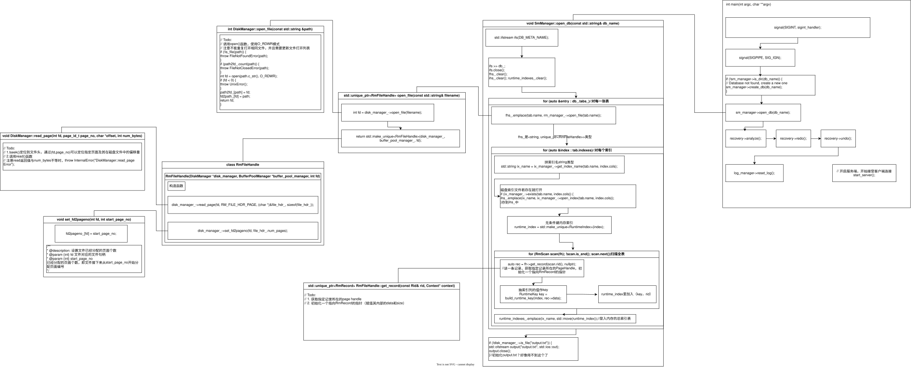

## sm_meta.h
**数据库元数据（metadata）的定义文件**

**定义的数据库**
```cpp
DbMeta（数据库）
 └─ map<string, TabMeta> tabs_          // 表名 → 表
      └─ TabMeta（表）
           ├─ vector<ColMeta> cols       // 表的列
           └─ vector<IndexMeta> indexes  // 表上的索引
                └─ IndexMeta（索引）
                     └─ vector<ColMeta> cols   // 索引包含的列
ColMeta（列）：最底层，描述"一个字段"
```

### 定义的结构

#### ColMeta · 一个字段

| 字段         | 作用                                          |
| ---------- | ------------------------------------------- |
| `tab_name` | 所属表名                                        |
| `name`     | 字段名                                         |
| `type`     | 类型（INT / FLOAT / STRING）                    |
| `len`      | 占多少字节                                       |
| `offset`   | **字段在整条记录里的起始偏移**（核心！`offset + len` 定位任何字段） |
| `index`    | 注释写明 **unused**，历史遗留                        |

#### IndexMeta · 一个索引

| 字段            | 作用                  |
| ------------- | ------------------- |
| `tab_name`    | 建在哪张表               |
| `col_tot_len` | 索引所有列总字节长           |
| `col_num`     | 索引包含几列              |
| `cols`        | 索引包含的列，**顺序即索引键顺序** |

#### TabMeta · 一张表

| 字段        | 作用   |
| --------- | ---- |
| `name`    | 表名   |
| `cols`    | 所有列  |
| `indexes` | 所有索引 |

| 方法                          | 返回         | 找不到时                        | 用途                    |
| --------------------------- | ---------- | --------------------------- | --------------------- |
| `is_col(name)`              | `bool`     | 返回 `false`                  | 判断列是否存在               |
| `is_index(col_names)`       | `bool`     | 返回 `false`                  | 判断某组列上是否有索引（**顺序敏感**） |
| `get_col(name)`             | `iterator` | **抛 `ColumnNotFoundError`** | 取列元数据                 |
| `get_index_meta(col_names)` | `iterator` | **抛 `IndexNotFoundError`**  | 取索引元数据（**顺序敏感**）      |

#### DbMeta · 一个数据库

| 成员               | 作用                            |
| ---------------- | ----------------------------- |
| `name_`（private） | 数据库名                          |
| `tabs_`（private） | `map<string, TabMeta>`，表名 → 表 |

| 方法                       | 作用                                          |
| ------------------------ | ------------------------------------------- |
| `is_table(name)`         | 表是否存在                                       |
| `SetTabMeta(name, meta)` | 增/改表                                        |
| `get_table(name)`        | 取表（返回 `TabMeta&`，找不到抛 `TableNotFoundError`） |

#### `<<`和`>>`运算符重载
`<<`改为输出到流os
`>>`改为从流里读

## rmdb.cpp



> *正在进行中*

### 数据库系统一般结构
```
┌────────────────────────────────────────────────────┐
│  上层：SQL 解析、查询优化、执行器                     │
├────────────────────────────────────────────────────┤
│  SmManager（存储管理器，就是 open_db 所在的类）       │
│    ├── rm_manager_  ← 记录管理器，管"表的数据文件"    │
│    ├── ix_manager_  ← 索引管理器，管"索引文件"        │
│    └── disk_manager_← 磁盘管理器，管"底层磁盘读写"    │
├─────────────────────────────────────────────────────┤
│  下层：操作系统文件系统 / 磁盘                        │
└─────────────────────────────────────────────────────┘
```

### SmManager的open_db
#### 主要功能
```text
SmManager::open_db
  └── rm_manager_->open_file("student")         
        └── RmManager::open_file("student")      
              ├── disk_manager_->open_file("student")   ← 真正打开磁盘文件
              └── make_unique<RmFileHandle>(...)        ← 打包成句柄对象
```

---

```cpp
std::ifstream ifs(DB_META_NAME);
```

打开输入文件流，然后从文件中把数据库信息加载到内存成员db_中
```cpp
for (auto &entry : db_.tabs_) {//对每张表，tabs_是一个表的map<string,TabMeta>
        auto &tab = entry.second;// tab是TabMeta型数据，包括string name,vector<ColMeta> cols;vector<IndexMeta> indexes;
        fhs_.emplace(tab.name, rm_manager_->open_file(tab.name)); // 为当前这张表打开它的数据文件，拿到文件句柄，然后登记到 fhs_ 这张"表名 → 文件句柄"的总表里
        for (auto &index : tab.indexes) {
            std::string ix_name = ix_manager_->get_index_name(tab.name, index.cols);
            if (ix_manager_->exists(tab.name, index.cols)) {
                ihs_.emplace(ix_name, ix_manager_->open_index(tab.name, index.cols));
            }
            auto runtime_index = std::make_unique<RuntimeIndex>(index);
            auto fh = fhs_.at(tab.name).get();
            for (RmScan scan(fh); !scan.is_end(); scan.next()) {
                auto rec = fh->get_record(scan.rid(), nullptr);
                RuntimeKey key = build_runtime_key(index, rec->data);
                runtime_index->entries_.emplace(std::move(key), scan.rid());
            }
            runtime_indexes_.emplace(ix_name, std::move(runtime_index));
        }
    }
```

记录管理器，用于管理表的数据文件，进行文件的创建、打开、删除、关闭

```cpp
class RmManager {
   private:
    DiskManager *disk_manager_;
    BufferPoolManager *buffer_pool_manager_;
```

```cpp
class SmManager {
   public:
    DbMeta db_;             // 当前打开的数据库的元数据
    std::unordered_map<std::string, std::unique_ptr<RmFileHandle>> fhs_;    // file name -> record file handle, 当前数据库中每张表的数据文件
    std::unordered_map<std::string, std::unique_ptr<IxIndexHandle>> ihs_;   // file name -> index file handle, 当前数据库中每个索引的文件
    std::unordered_map<std::string, std::unique_ptr<RuntimeIndex>> runtime_indexes_;
   private:
    DiskManager* disk_manager_;
    BufferPoolManager* buffer_pool_manager_;
    RmManager* rm_manager_;//表的数据文件（记录）,记录管理器record manager
    IxManager* ix_manager_;//索引
}
```

```
fhs_.emplace(tab.name, rm_manager_->open_file(tab.name)); 
```

为当前这张表打开它的数据文件，拿到文件句柄，然后登记到 fhs_ 这张"表名 → 文件句柄"的总表里

```text
fhs_  .  emplace(  key        ,  value  )
│        │         │             │
│        │         │             └── rm_manager_->open_file(tab.name)
│        │         │                   "让记录管理器打开这张表的文件，返回句柄"
│        │         └── tab.name
│        │              "用表名当 key"
│        └── 往 fhs_ 里插入一对 (key, value)
└── 存"表名 → 文件句柄"的总表
```

第 1 步：`rm_manager_->open_file("student")`
         → 打开 student.dat，返回 handle（真实 IO 发生在这里）
第 2 步：`emplace("student", handle)`
         → 在 fhs_ 里就地构造一对 ("student", handle)
         → handle 被移动进 map（unique_ptr 不能拷贝）
第 3 步：`fhs_` 里多了一条记录

### disk_manager的read_page和set_fd2pageno

```
RmFileHandle 构造函数
  └── disk_manager_->read_page(fd, RM_FILE_HDR_PAGE, (char*)&file_hdr_, sizeof(file_hdr_))
        └── DiskManager::read_page   ← 这段代码，真正读磁盘
  └── disk_manager_->set_fd2pageno(fd, file_hdr_.num_pages)
        └── fd2pageno_[fd] = ...      ← 页号计数器
```

#### `read_page` 

> **给定 fd、页号、目标缓冲区、要读多少字节，把磁盘上"这一页对应位置"的字节读进内存缓冲区。读不够就重试，最终还读不够就报错。**


```cpp
void DiskManager::read_page(int fd, page_id_t page_no, char *offset, int num_bytes)
//                                                      ↑ 这个叫 offset，但它是"内存目标缓冲区指针"，不是文件偏移！
```

真正的**文件偏移**是函数内部算出来的局部变量 `file_offset`。读代码时别把两个 `offset` 搞混。

##### 第 1 行：页号 → 字节偏移

```cpp
const off_t file_offset = static_cast<off_t>(page_no) * PAGE_SIZE;
```

- `page_no`：页号（比如 `0` 表示文件头页，`1` 表示第一个数据页）
- `PAGE_SIZE`：每页多少字节（常见 `4096`）
- **页号 × 页大小 = 这一页在文件里的字节起点**

```
文件布局（PAGE_SIZE = 4096）：

字节偏移 0      ──► 第 0 页（文件头）
字节偏移 4096   ──► 第 1 页
字节偏移 8192   ──► 第 2 页
...
第 n 页的起点 = n * 4096
```

- `static_cast<off_t>(page_no)`：把页号转成 `off_t`（文件偏移类型，通常是 64 位有符号整数），**防止乘法溢出**。如果 `page_no` 是 `int`，`int * PAGE_SIZE` 可能溢出；先转成 64 位再乘就安全。
- `const`：这个偏移算出来就不会变，标 `const` 表达"只读"。

**举例**：`read_page(fd, 0, buf, 24)` → `file_offset = 0 * 4096 = 0`。

##### 第 2 行：已读字节计数器

```cpp
ssize_t read_bytes = 0;
```

- `read_bytes` 记录"**到目前为止已经读了多少字节**"
- `ssize_t`：有符号的"大小类型"（通常是 64 位），系统调用 `read`/`pread` 的返回类型。

##### 第 3 行：循环

```cpp
while (read_bytes < num_bytes) {
```

**核心问题：`pread` 可能"短读"（short read）。**

请求读 `num_bytes` 字节，`pread` 可能只返回**少于** `num_bytes` 的字节数。常见原因：

| 原因     | 说明                          |
| ------ | --------------------------- |
| 信号中断   | 读一半被信号打断（返回 `-1` + `EINTR`） |
| 网络文件系统 | NFS 等可能分批返回                 |
| 管道/终端  | 不是普通文件时天然可能短读               |
| 到达文件末尾 | 文件不够长，读到末尾就停                |
| 内核实现限制 | 单次读的字节数有上限                  |

**所以健壮的读必须循环**，直到读满 `num_bytes` 或出错。

##### 第 4 行：真正的读

```cpp
ssize_t result = pread(fd, offset + read_bytes, num_bytes - read_bytes, file_offset + read_bytes);
```

四个参数：

| 参数                         | 值              | 含义                   |
| -------------------------- | -------------- | -------------------- |
| `fd`                       | 文件描述符          | 读哪个文件                |
| `offset + read_bytes`      | 内存缓冲区指针 + 已读偏移 | **往内存的哪个位置写**（接着上次写） |
| `num_bytes - read_bytes`   | 还差多少字节         | **这次要读多少**           |
| `file_offset + read_bytes` | 文件偏移 + 已读偏移    | **从文件的哪个位置读**（接着上次读） |

**关键：`pread` 是"带显式偏移的读"**，它自己定位，**不改变文件的当前偏移量**。

`pread` 签名：

```c
ssize_t pread(int fd, void *buf, size_t count, off_t offset);
//                              ↑读多少   ↑从文件的哪个字节开始读
```

**为什么用 `pread` 而不是 `lseek + read`？**

注释里写的是"1. lseek 定位，2. 调用 read"，但**实际代码用了 `pread`**，这是更好的写法：

|        | `lseek + read`         | `pread`           |
| ------ | ---------------------- | ----------------- |
| 定位     | 改文件当前偏移量               | 不改，显式传偏移          |
| 多线程    | **不安全**：两个线程共享偏移量会互相干扰 | **安全**：每个线程传自己的偏移 |
| 系统调用次数 | 2 次（lseek + read）      | 1 次               |
| 适用场景   | 单线程顺序读写                | 随机读、多线程           |

**数据库天然是随机读（按页号读），且可能多线程，所以 `pread` 是正确选择。** 注释没更新，以代码为准。

##### 第 5~7 行：处理 `EINTR`

```cpp
if (result < 0 && errno == EINTR) {
    continue;
}
```

- `result < 0`：`pread` 失败
- `errno == EINTR`：失败原因是"**被信号中断**"（Error INTerrupted）

**`EINTR` 是什么？** 当进程在等系统调用（比如读磁盘）时，如果来了一个信号（比如 `SIGCHLD`、`SIGALRM`），系统调用可能被**提前打断**，返回 `-1` 并设 `errno = EINTR`。这不是真错误，**重试即可**。

`continue` 回到 `while` 条件，`read_bytes` 没变，所以**从原位置重新读**，不会丢数据也不会重复。

> 现代系统很多系统调用会自动重启（`SA_RESTART`），但**不能假设**，显式处理 `EINTR` 是健壮代码的标准做法。

##### 第 8~10 行：其他失败情况

```cpp
if (result <= 0) {
    throw InternalError("DiskManager::read_page Error");
}
```

`result <= 0` 包括两种情况：

| `result`                 | 含义                              | 为什么报错             |
| ------------------------ | ------------------------------- | ----------------- |
| `< 0` 且 `errno != EINTR` | 真错误（fd 无效、IO 错误、偏移越界等）          | 必须报错              |
| `== 0`                   | **读到文件末尾**（EOF），没读够 `num_bytes` | 说明文件比预期短，数据不完整，报错 |

**为什么 `== 0` 也报错？** 因为调用方要的是"读满 `num_bytes`"。读到 0 说明文件不够长——对数据库来说，这意味着**文件损坏或元数据不一致**（比如文件头说 `num_pages=10`，实际文件只有 5 页），必须当错误处理。

**`InternalError`** 是项目自定义异常，表示"内部一致性错误"，比 `UnixError` 更严重——不是用户操作问题，是系统状态不对。

##### 第 11 行：累加已读

```cpp
read_bytes += result;
```

把这次实际读到的字节数累加。下一轮循环：

- 内存写位置往后移 `result`
- 文件读位置往后移 `result`
- 剩余要读的字节数减少 `result`

**循环终止条件**：`read_bytes == num_bytes`，正好读满。
